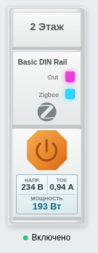

# Sonoff DIN Rail Card

Карточка Home Assistant для отображения и управления несколькими DIN-реле в одном ряду. Поддерживает сущности `switch` и `light`.

### Классический корпус


### Компактный корпус


### Дисплей показаний



## Возможности

- Компактный корпус без винтов или классический корпус.
- Названия, состояние и индикаторы каждого реле.
- Живые напряжение (В), ток (А) и мощность (Вт) в увеличенном дисплее под оранжевой кнопкой.
- Настраиваемые короткое, долгое и двойное нажатия для каждого реле.
- Автоматическая подгонка ряда по ширине, масштабирование и горизонтальная прокрутка.
- Визуальный редактор карточки в Home Assistant.

## Установка

1. Скачайте [архив последнего релиза](https://github.com/rbalaev/sonoff-din-rail-card/releases/latest) и скопируйте три файла — `sonoff-din-rail-card.js`, `sonoff-din-rail-card.svg`, `sonoff-din-rail-card-compact.svg` — в `/config/www/community/sonoff-din-rail-card/`.
2. Добавьте ресурс JavaScript-модуля в **Настройки → Панели управления → Ресурсы**:
   `/local/community/sonoff-din-rail-card/sonoff-din-rail-card.js?v=2.14`
3. Обновите страницу и добавьте **Sonoff DIN Rail Card** через редактор карточек.

## Пример YAML

```yaml
type: custom:sonoff-din-rail-card
title: Реле щита
design: compact
entities:
  - entity: switch.gate
    name: Ворота
    tap_action:
      action: toggle
    hold_action:
      action: more-info
  - entity: switch.pump
    name: Насос
    voltage_entity: sensor.pump_voltage
    current_entity: sensor.pump_current
    power_entity: sensor.pump_power
```

`entities` — список реле; порядок в списке определяет порядок в карточке. Для каждого реле можно задать `name`, `tap_action`, `hold_action` и `double_tap_action`. Доступны стандартные действия Home Assistant: `toggle`, `more-info`, `navigate`, `url`, `perform-action`, `assist` и `none`.

`voltage_entity`, `current_entity` и `power_entity` задаются отдельно для каждого реле (через YAML или раздел «Показания под кнопкой» в редакторе). Без них карточка читает одноимённые атрибуты самого `switch`/`light`; отсутствующее значение показывает как `—`, не подменяя его нулём. Поддерживаются единицы V/В, A/А/mA и W/Вт/kW; kW переводятся в Вт, mA — в А. При большом числе реле ряд прокручивается горизонтально, чтобы цифры оставались читаемыми.

`design: compact` выбирает корпус без винтов; `design: full` — классический вариант. `fit: true` подгоняет ряд по ширине карточки. Параметр `scale` задаёт масштаб от `0.25` до `1.5` (по умолчанию `1`).
