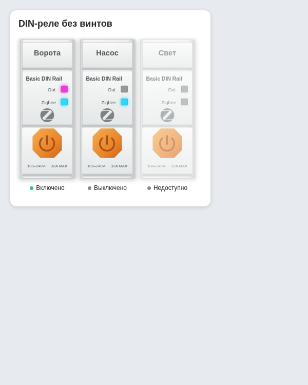

# Sonoff DIN Rail Card

Кастомная карточка Home Assistant для нескольких DIN-реле в один ряд. Число модулей задаётся списком сущностей; кнопка на каждом модуле переключает соответствующее реле. Поддерживаются `switch.*` и `light.*`.

**Рабочая версия: 2.12.** Проверена в Home Assistant. Настройки нажатий задаются отдельно для каждого реле: при проверке выбирайте кнопку именно того модуля, действия которого меняли в редакторе.



## Установка

1. Скопировать `sonoff-din-rail-card.js`, `sonoff-din-rail-card.svg` и `sonoff-din-rail-card-compact.svg` **в одну папку**. Например, `/config/www/community/sonoff-din-rail-card/` Home Assistant.
2. В **Настройки → Панели управления → Ресурсы** добавить JavaScript-модуль `/local/community/sonoff-din-rail-card/sonoff-din-rail-card.js?v=2.12`.
3. Перезагрузить страницу панели управления (при необходимости — обновить кэш браузера).
4. Добавить карточку **Sonoff DIN Rail Card** через редактор: кнопка **«Добавить реле»** создаёт очередной модуль, выпадающий список выбирает сущность. Порядок строк равен порядку модулей.

## YAML

```yaml
type: custom:sonoff-din-rail-card
title: Реле щита
scale: 1
fit: true
design: compact
entities:
  - entity: switch.relay_1
    name: Ворота
    tap_action:
      action: toggle
    hold_action:
      action: more-info
    double_tap_action:
      action: perform-action
      perform_action: script.turn_on
      target:
        entity_id: script.open_gate
  - entity: switch.relay_2
    name: Насос
  - switch.relay_3
```

Изменение количества модулей — добавить или удалить строки в `entities`. По умолчанию векторный рисунок реле берётся из той же папки, что и JS. Если нужен другой рисунок, указать `image: /local/путь/к/рисунку.svg`.

`design: compact` включает короткий корпус без видимых винтов, как на втором образце. В редакторе это пункт **«Компактный, без винтов»**. Если `design` не указан или равен `full`, остаётся прежний рисунок с винтами. Индикаторы доступности и состояния, а также оранжевая кнопка управления работают в обоих вариантах.

Значок на корпусе использует узнаваемую векторную форму Zigbee (контур Simple Icons, CC0), вместо условной буквы Z.

Имя реле (`name` либо дружественное имя сущности) показывается на лицевой панели вместо надписи SONOFF. Под корпусом остаётся только статус. Полное имя доступно в подсказке, если оно не помещается в узком модуле.

При `fit: true` (по умолчанию) ряд при `scale: 1` подгоняется под ширину карточки: 10 реле видны сразу. `scale` (0.25–1.5) изменяет фактический размер от этой базы: при 150% реле становятся в полтора раза крупнее, а ряд прокручивается горизонтально. При `fit: false` за базу берётся физический размер рисунка (112 px на модуль), также умножаемый на `scale`. Ширину самой колонки панели Home Assistant карточка не меняет. В очень узком модуле длинное имя сокращается многоточием; полное имя остаётся в подсказке.

Карточка не меняет режимы самого устройства и не управляет сценами Zigbee2MQTT: она вызывает `switch.turn_on/off` или `light.turn_on/off` для выбранных сущностей Home Assistant. Недоступные и не найденные сущности отображаются без активной кнопки.

По умолчанию оранжевая кнопка переключает реле. Верхний индикатор `Out` горит розовым при состоянии `on`; нижний `Zigbee` горит голубым, когда сущность в HA доступна (`on` или `off`). Если сущность имеет состояние `unavailable`/`unknown`, оба индикатора погашены; переключение не выполняется, но другие настроенные действия кнопки остаются доступными.

Действия срабатывают **только на оранжевой кнопке**, не на всём корпусе. Для каждого реле отдельно настраиваются `tap_action`, `hold_action` и `double_tap_action` в редакторе или YAML. Доступны `toggle`, `more-info`, `navigate`, `url`, `perform-action` (также совместимый `call-service`), `assist`, `none` и `fire-dom-event`. По умолчанию: короткое — переключение, долгое — сведения о сущности, двойное — ничего. Для `perform-action` можно задать `perform_action`, `data`, `target`; для перехода — `navigation_path`; для URL — `url_path`. Дополнительные параметры Home Assistant можно прописать в YAML, включая `confirmation`, `navigation_replace`, `entity`, `pipeline_id` и `start_listening`. В браузере `assist` открывает страницу «Ассистент»; в мобильном приложении — нативный Assist.

Редактор не перерисовывает список реле при обычных обновлениях состояний Home Assistant: выпадающее меню остаётся открытым до выбора.
Сама карточка при обновлениях состояний меняет только индикаторы и статус без пересоздания кнопок: удержание не может случайно превратиться в короткое нажатие.
Редактор показывает строку «Версия 2.12». Если после обновления её нет, браузер всё ещё загрузил старый JS.
